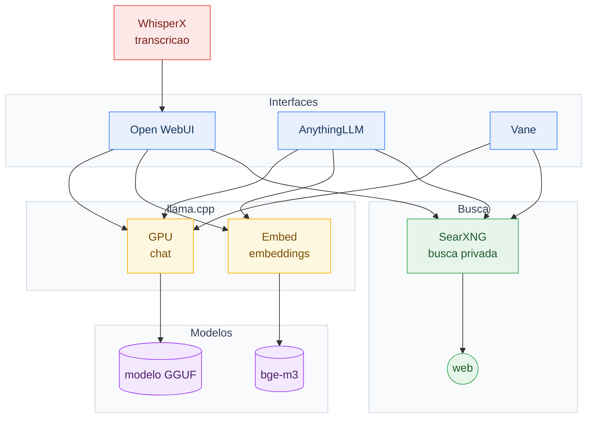
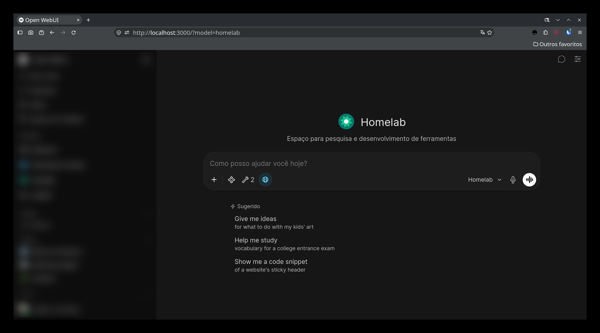
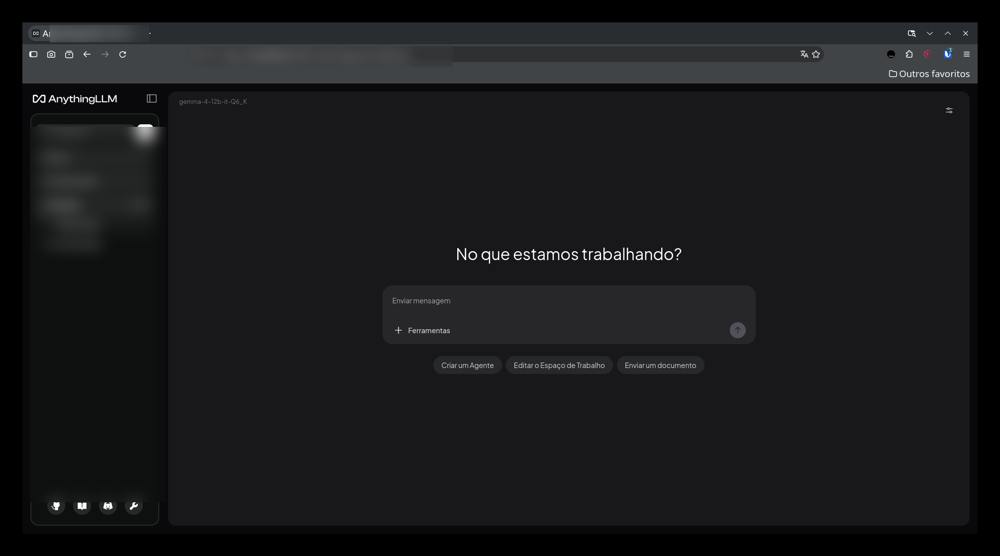
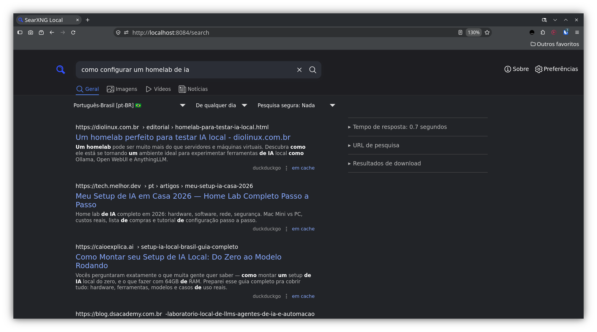
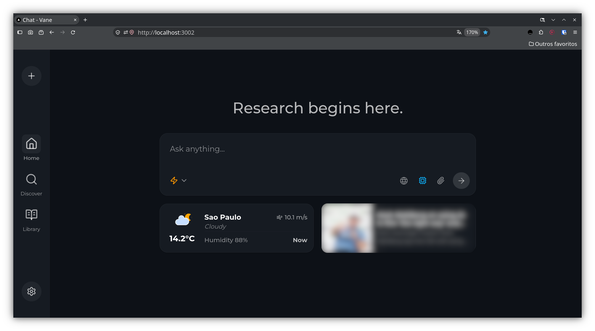

# Homelab Llama

Versão atual: **1.1.0** (tag [`v1.1.0`](https://github.com/eddiecsilva/homelab-llama/releases/tag/v1.1.0))

> [!WARNING]
> **Aviso:** este lab foi planejado e testado apenas em ambientes isolados na rede local. Não é indicado para uso em ambientes de produção real.

Ambiente local de IA com 8 serviços Docker: chat com modelos da sua máquina, RAG sobre seus documentos, busca privada, transcrição de áudio e leitura de feeds. Sem nuvem, sem custo de API, sem seus dados saindo de casa.

Homelab Llama reúne 8 serviços de IA em containers Docker que rodam na sua máquina: chat com modelos locais (llama.cpp), três interfaces web para conversar e pesquisar (Open WebUI, AnythingLLM e Vane), transcrição de áudio e vídeo (WhisperX), busca privada (SearXNG) e leitura de feeds (FreshRSS). Nada sai da máquina - modelos, documentos e histórico ficam em disco local, e o único pré-requisio real é uma GPU NVIDIA com o NVIDIA Container Toolkit configurado.

## 📑 Índice

- [Visão geral](#visao-geral)
- [Instalação](#instalacao)
- [Capturas de tela](#capturas-de-tela)
- [Hardware](#hardware)
- [Modelos](#modelos)
- [Acesso e autenticação](#acesso-e-autenticacao)
- [Troubleshooting](#troubleshooting)
- [Links externos](#links-externos)
- [Changelog](#changelog)
- [Licença](#licenca)
---

<a id="visao-geral"></a>

## 🚀 Visão Geral

| Serviço | O que faz | Acesso local | Serviço no compose | Site oficial |
|---------|-----------|--------------|--------------------|--------------|
| Open WebUI | Chat, RAG sobre documentos e busca web | http://localhost:3000 | `open-webui` | [openwebui.com](https://openwebui.com) |
| AnythingLLM | Base de conhecimento sobre seus documentos | http://localhost:3001 | `anythingllm` | [anythingllm.com](https://anythingllm.com) |
| Vane | Busca web com resposta e citações | http://localhost:3002 | `vane` | [github.com/ItzCrazyKns/Vane](https://github.com/ItzCrazyKns/Vane) |
| SearXNG | Metabusca privada (agrega vários motores) | http://localhost:8084 | `searxng` | [github.com/searxng/searxng](https://github.com/searxng/searxng) |
| FreshRSS | Leitor de feeds RSS | http://localhost:3003 | `freshrss` | [freshrss.org](https://freshrss.org) |
| WhisperX | Transcrição de áudio/vídeo com timestamps | http://localhost:9000 (API) | `whisperx` | [github.com/m-bain/whisperX](https://github.com/m-bain/whisperX) |
| llama.cpp (GPU) | Servidor do modelo de chat | http://localhost:8085 (API) | `llama-gpu` | [github.com/ggml-org/llama.cpp](https://github.com/ggml-org/llama.cpp) |
| llama.cpp (Embed) | Vetores para RAG | http://localhost:8086 (API) | `llama-embed` | [github.com/ggml-org/llama.cpp](https://github.com/ggml-org/llama.cpp) |

> [!NOTE]
> As portas vêm do `.env` (`OPENWEBUI_PORT`, `VANE_PORT`, `SEARXNG_PORT`, ...) e a tabela segue o `.env.example`. De dentro de outro container, use `host.docker.internal` no lugar de `localhost`.

---

<a id="instalacao"></a>

## 📦 Instalação

### Pré-requisitos

- **Docker** 20.10+ com **Compose Plugin** 2.0+
- **NVIDIA Container Toolkit** (para a GPU) - [guia de instalação](https://docs.nvidia.com/datacenter/cloud-native/container-toolkit/latest/install-guide.html)
- **Windows:** WSL2 com [Docker Desktop](https://www.docker.com/products/docker-desktop)

```bash
# Ubuntu/Debian
sudo apt install docker.io docker-compose-plugin -y
sudo usermod -aG docker $USER && newgrp docker

# Conferir a GPU no container
docker run --rm --gpus all nvidia/cuda:12.1.0-base-ubuntu22.04 nvidia-smi
```

### Passos

1. **Copiar o template de configuração**

   Escolha o template que cabe na sua máquina (veja [perfis de hardware](#perfis-de-hardware)):

   ```bash
   cd homelab-llama
   cp .env.example .env          # perfil padrão: 16 GB de VRAM, 32 GB+ de RAM
   # ou, para 8 GB de VRAM e 16 GB de RAM:
   # cp .env.example.small .env
   ```

2. **Gerar os secrets criptográficos**

   ```bash
   for k in WEBUI_SECRET_KEY ANYTHINGLLM_SIG_KEY ANYTHINGLLM_SIG_SALT SEARXNG_SECRET FRESHRSS_PASSWORD FRESHRSS_API_PASSWORD; do
     sed -i "s|^$k=.*|$k=$(openssl rand -hex 32)|" .env
   done
   ```

3. **Configurar o SearXNG** (o `settings.yml` não é versionado porque tem o `secret_key`)

   ```bash
   cp config/searxng/settings.example.yml config/searxng/settings.yml
   sed -i "s|^  secret_key: .*|  secret_key: $(openssl rand -hex 32)|" config/searxng/settings.yml
   ```

   Opcional: o container lê `SEARXNG_SECRET` do `.env` e sobrepõe o `secret_key` do arquivo, então o `sed` é redundante se você já preencheu a variável.

4. **Subir os serviços**

   ```bash
   docker compose up -d
   docker compose ps
   ```

   Cada serviço tem `healthcheck` e o Compose espera os backends ficarem saudáveis antes de subir as interfaces.

> [!WARNING]
> O `.env` ainda tem campos em branco para você preencher: `CHAT_MODEL`, `MODELS_DIR` e `FRESHRSS_USERNAME`. Sem modelo em `$MODELS_DIR/chat` o chat não responde.

### Como ficam os nomes dos containers

O Docker Compose monta o nome como `<COMPOSE_PROJECT_NAME>-<serviço>-<número>`, por exemplo `hmlb-cpp-open-webui-1`. O prefixo vem do `.env`, então muda de máquina para máquina.

Nos comandos do Compose use o **nome do serviço** do `compose.yaml` (`open-webui`, `searxng`, `llama-gpu`...). Para ver os nomes reais, com portas e redes de cada container:

```bash
docker ps --format 'table {{.Names}}\t{{.Ports}}\t{{.Networks}}'
```

### Comandos frequentes

```bash
docker compose logs -f              # logs de todos os serviços
docker compose logs -f open-webui   # logs de um serviço
docker compose restart open-webui   # reiniciar um serviço
docker compose down                 # parar (mantém os dados)
docker compose down -v              # remover tudo, inclusive os dados
docker compose pull && docker compose up -d   # atualizar as imagens
```

---

<a id="capturas-de-tela"></a>

## 📸 Capturas de Tela

Na prática o conjunto funciona como uma casa única para IA local: você conversa e faz perguntas em três interfaces diferentes (Open WebUI, AnythingLLM e Vane), todas apoiadas no mesmo modelo GGUF servido pelo llama.cpp e nos mesmos embeddings (bge-m3) para busca semântica nos seus documentos; atrás delas o SearXNG faz a busca na web sem rastrear você, o WhisperX transcreve áudios com marcação de tempo e o FreshRSS concentra os feeds. O Vane junta busca, resposta do modelo e citações; o AnythingLLM mantém bases de conhecimento separadas por workspace.



*Cada seta indica quem chama quem: as interfaces pedem chat ao llama.cpp, embeddings ao bge-m3 e busca ao SearXNG; o WhisperX entrega transcrição para o Open WebUI.*

## **Open WebUI** - chat, RAG e busca web em uma tela só.



## **AnythingLLM** - documentos e bases de conhecimento por workspace.



## **SearXNG** - a busca por trás de tudo, sem rastreamento.



## **Vane** - busca com resposta do modelo e citações.



## **WhisperX** - não tem interface própria; acompanhe a transcrição pelo log:

```bash
docker compose logs whisperx
```

### Como o WhisperX é configurado

A imagem `learnedmachine/whisperx-asr-service` **não lê variáveis com prefixo `WHISPERX_`**. Ela lê `DEVICE`, `COMPUTE_TYPE`, `BATCH_SIZE`, `ALIGN_DEVICE`, `CACHE_DIR`, `DEFAULT_MODEL`, `MAX_LOADED_MODELS`, `MAX_FILE_SIZE_MB`, `MODEL_KEEP_ALIVE_SECONDS`, `MODEL_EVICTION_INTERVAL_SECONDS`, `HF_TOKEN` e `LOG_LEVEL`. O `compose.yaml` faz essa tradução a partir das variáveis `WHISPERX_*` do `.env`, que existem só para o seu lado.

Idioma e prompt são parâmetros de cada requisição, não do ambiente:

```bash
# API do WhisperX
curl -s -F "audio_file=@audio.mp3" \
  "http://localhost:9000/asr?model=large-v3&language=pt&output_format=json"

# API compativel com OpenAI (mesma que o Open WebUI usa)
curl -s -F "file=@audio.mp3" -F "model=large-v3" -F "language=pt" \
  "http://localhost:9000/v1/audio/transcriptions"
```

No Open WebUI, o STT fica em Admin → Configurações → Áudio, com o motor `OpenAI` e a URL `http://whisperx:9000/v1`.

| Variável | Efeito |
|---|---|
| `WHISPERX_BATCH_SIZE` | janelas de 30 s processadas em paralelo na GPU. Acima de 4 o `large-v3` estoura a VRAM |
| `WHISPERX_ALIGN_DEVICE` | `cpu` (padrão) poupa ~1,9 GB de VRAM e deixa o alinhamento ~3x mais lento; `cuda` é mais rápido |
| `WHISPERX_MODEL` | `large-v3` (4,2 GB de VRAM), `large-v3-turbo` (2,5 GB) ou `medium` (2,6 GB) |
| `WHISPERX_CACHE_DIR` | cache do Hugging Face. No padrão (`/app/models`) o modelo de ~3 GB fica no volume e não é baixado de novo |
| `WHISPERX_MODEL_KEEP_ALIVE_SECONDS` | descarrega o modelo da GPU após X segundos ocioso |
| `HF_TOKEN` | habilita a diarização (falantes `SPEAKER_00`) via pyannote `community-1` |

### Orçamento de VRAM

Medido na RTX 5070 Ti (16 GB) com `gemma-4-12b-it-Q6_K`:

| Componente | VRAM |
|---|---:|
| Desktop (Xorg, Wayland) | ~1,4 GB |
| llama.cpp (12B Q6_K, contexto 16384, KV q8_0) | 10,3 GB |
| llama.cpp (12B Q6_K, contexto 32768 / 65536) | 10,5 GB / 12,2 GB |
| WhisperX `large-v3` (batch 2, alinhamento na CPU) | 4,2 GB |
| WhisperX `large-v3` (batch 4, alinhamento na GPU) | 7,4 GB |
| WhisperX `large-v3-turbo` (batch 2, alinhamento na CPU) | 2,4 GB |

O chat e a transcrição dividem a mesma GPU. O router do llama.cpp só carrega o modelo sob demanda, então na maior parte do tempo a transcrição roda com a VRAM livre. Quando precisar transcrever com o modelo de chat carregado, use `WHISPERX_MODEL=large-v3-turbo` ou espere o servidor dormir (`LLAMA_SLEEP_IDLE_SECONDS=300` libera a VRAM após 5 minutos ocioso).

Aplicativos de desktop com aceleração (Resolve, Premiere) consomem VRAM fora do Docker e quebram esse orçamento.

---

<a id="hardware"></a>

## 💻 Hardware

Testado em: AMD Ryzen 5 5700X (8 núcleos/16 threads), 48GB RAM, NVIDIA RTX 5070 Ti 16GB (CUDA), SSD NVMe 200GB+, Debian 13.

<a id="perfis-de-hardware"></a>

### Perfis de hardware

Dois templates de `.env`, um por faixa de máquina:

| | Perfil padrão | Perfil pequeno |
|---|---|---|
| Template | `.env.example` | `.env.example.small` |
| GPU | 16 GB de VRAM | 8 GB de VRAM |
| RAM | 32 GB+ | 16 GB |
| Modelo de chat | 12B em Q6_K (~9,1 GB) | 8B em Q4_K_M (~4,9 GB) |
| Contexto do chat | 16384 | 8192 |
| WhisperX | `large-v3` (~4,2 GB de VRAM) | `medium` (~2,6 GB de VRAM) |
| Chat e transcrição juntos | cabem (14,7 GB) | não cabem: o chat dorme (`LLAMA_SLEEP_IDLE_SECONDS`) |

Mínimo do perfil padrão: 8 núcleos, 32 GB de RAM, GPU NVIDIA 16 GB, 100 GB livres.
Mínimo do perfil pequeno: 8 núcleos, 16 GB de RAM, GPU NVIDIA 8 GB, 60 GB livres. Com 16 GB de RAM a máquina precisa ser headless ou ter o desktop fechado: os 8 serviços somam ~5 GB e o SO leva o resto.

### Qual GGUF usar

O GGUF é o que pesa na VRAM. O peso do arquivo é praticamente o que o modelo ocupa na GPU, mais o KV cache e o buffer de computação:

| Modelo | Quantização | Tamanho do GGUF | VRAM com ctx 16384 |
|---|---|---:|---:|
| 12B | Q6_K | 9,1 GB | 10,5 GB |
| 12B | Q5_K_M | 7,6 GB | 9,0 GB |
| 9B | Q4_K_M | 5,5 GB | 6,9 GB |
| 8B | Q4_K_M | 4,9 GB | 6,3 GB |
| 8B | Q3_K_M | 3,9 GB | 5,3 GB |
| 7B | Q4_K_M | 4,4 GB | 5,8 GB |

Regra prática: **perfil padrão → GGUF de até ~9 GB; perfil pequeno → GGUF de até ~4,5 GB**. Qualquer coisa acima disso não entra na VRAM junto com o WhisperX. Se precisar de mais qualidade, use um modelo maior com quantização mais agressiva (Q3/Q2) ou reduza `LLAMA_CTX_SIZE`.

### Verificar antes de subir

```bash
python3 scripts/check-hardware.py
```

O script lê o `.env`, mede a VRAM da GPU e a RAM da máquina, abre o GGUF do `CHAT_MODEL` e diz se o perfil cabe — e o que mexer se não couber. Ele aceita `--vram 8 --ram 16` para simular outra máquina.

> [!TIP]
> Os números de VRAM do script são estimativas calibradas nas medições do homelab (llama.cpp 0.7, whisperx 0.4.3). Erro de ~5% para o normal.

---

<a id="modelos"></a>

## 🤖 Modelos

O stack usa **llama.cpp** em modo router: o modelo carregado é definido por `CHAT_MODEL` no `.env`.

- **Chat:** arquivo GGUF em `$MODELS_DIR/chat` e nome em `CHAT_MODEL`.
- **Embeddings:** modelo baixado automaticamente de `EMBEDDING_HF_REPO` (`bge-m3` por padrão), usado por Open WebUI e AnythingLLM no RAG.

```bash
# Ver modelo carregado e memória usada
docker compose logs -f llama-gpu

# Listar modelos no container
docker compose exec llama-gpu ls /models/chat
```

> [!NOTE]
> Não existe `ollama pull` aqui: os modelos são arquivos GGUF servidos pelo llama.cpp.

---

<a id="acesso-e-autenticacao"></a>

## 🔐 Acesso e Autenticação

| Serviço | Entrar com |
|---------|-----------|
| FreshRSS | usuário `FRESHRSS_USERNAME` e senha `FRESHRSS_PASSWORD` do `.env` |
| AnythingLLM | organize e defina as credenciais administrativas na primeira abertura |
| Open WebUI | crie a conta no primeiro acesso (signup habilitado) |

> [!TIP]
> O container do FreshRSS só cria o usuário na primeira instalação. Depois disso, trocar a senha no `.env` não altera a senha atual - mude pela interface (Configurações > Conta) e ajuste o `.env`.

---

<a id="troubleshooting"></a>

## 🩺 Troubleshooting

```bash
docker compose ps                # quem está de pé
docker compose logs <serviço>    # log de um serviço
nvidia-smi && free -h            # GPU e memória
```

Erros de memória: reduza `LLAMA_MODELS_MAX` e `LLAMA_CTX_SIZE` no `.env`.
Erros de GPU: reinicie o Docker (`sudo systemctl restart docker`) e teste com `docker run --rm --gpus all nvidia/cuda:12.1.0-base-ubuntu22.04 nvidia-smi`.

### Transcrição falha com `CUDA failed with error out of memory`

A GPU está cheia. O WhisperX e o modelo de chat disputam os mesmos 16 GB.

1. Feche aplicativos que usam a GPU fora do Docker (Resolve, Premiere, jogos).
2. Reduza `WHISPERX_BATCH_SIZE` para 1 ou 2 e mantenha `WHISPERX_ALIGN_DEVICE=cpu`.
3. Troque `WHISPERX_MODEL=large-v3-turbo` (2,4 GB em vez de 4,2 GB).
4. Espere o modelo de chat dormir: `LLAMA_SLEEP_IDLE_SECONDS=300` libera a VRAM após 5 minutos ocioso.

### Transcrição falha com `parallel_for failed: cudaErrorInvalidDevice`

O modelo ficou envenenado na VRAM depois de um OOM e o serviço o reaproveita por até `WHISPERX_MODEL_KEEP_ALIVE_SECONDS` segundos. A reinicialização do container resolve:

```bash
docker compose restart whisperx
```

### Chat lento ou sem resposta

O modelo não cabe na VRAM com o contexto configurado. Reduza `LLAMA_CTX_SIZE` (16384 usa 10,3 GB contra 12,2 GB de 65536) e ajuste `CONTEXT_COMPACTION_TOKEN_THRESHOLD` e `CONTEXT_COMPACTION_TOKEN_CAP` no `.env` junto com ele.

Os dados ficam em `data/` (bind mount) e em `$MODELS_DIR/` - faça backup antes de mexer.

---

<a id="links-externos"></a>

## 🔗 Links Externos

Documentação de cada serviço:

- Open WebUI - [docs.openwebui.com](https://docs.openwebui.com)
- AnythingLLM - [docs.anythingllm.com](https://docs.anythingllm.com)
- Vane - [discussions no GitHub](https://github.com/ItzCrazyKns/Vane/discussions)
- SearXNG - [docs.searxng.org](https://docs.searxng.org)
- FreshRSS - [freshrss.github.io](https://freshrss.github.io)
- WhisperX - [whisperx-asr-service no GitHub](https://github.com/murtaza-nasir/whisperx-asr-service)
- llama.cpp - [ggml-org.github.io](https://ggml-org.github.io)

### Ferramentas de apoio

| Ferramenta | Link |
|------------|------|
| Docker Desktop / Engine | [docker.com](https://www.docker.com/products/docker-desktop) |
| NVIDIA Container Toolkit | [docs.nvidia.com/datacenter/cloud-native/container-toolkit](https://docs.nvidia.com/datacenter/cloud-native/container-toolkit/latest/install-guide.html) |
| Hugging Face (modelos) | [huggingface.co](https://huggingface.co) |

### Leitura recomendada

- **[Homelab de IA n8n Ollama Qdrant - Diolinux](https://plus.diolinux.com.br/t/construindo-um-homelab-de-ia-n8n-ollama-e-qdrant-para-testes-e-aprendizado/81764)** - Uma das primeiras versões deste tipo de homelab, com configurações detalhadas.
- **[Debian 13 Post-Installation Repository](https://github.com/eddiecsilva/debian-post-install)** - Guia de configuração pós-instalação para Debian 13, incluindo otimizações para desenvolvimento e IA.

---

<a id="changelog"></a>

## 📋 Changelog

Histórico de versões em [CHANGELOG.md](CHANGELOG.md).

| Versão | Data | Resumo |
|---------|------|--------|
| 1.1.0 | 2026-10-22 | Correções do WhisperX (VRAM, env, cache, HF_TOKEN), provider do AnythingLLM, STT do Open WebUI, VRAM do llama.cpp, healthchecks e rotação de log |
| 1.0.0 | 2026-10-20 | Primeira release estável: 8 serviços, hardware de referência, modelos e limitações conhecidas |

---

<a id="licenca"></a>

## 📝 Licença

[MIT](LICENSE) - uso pessoal, educativo e comercial.
